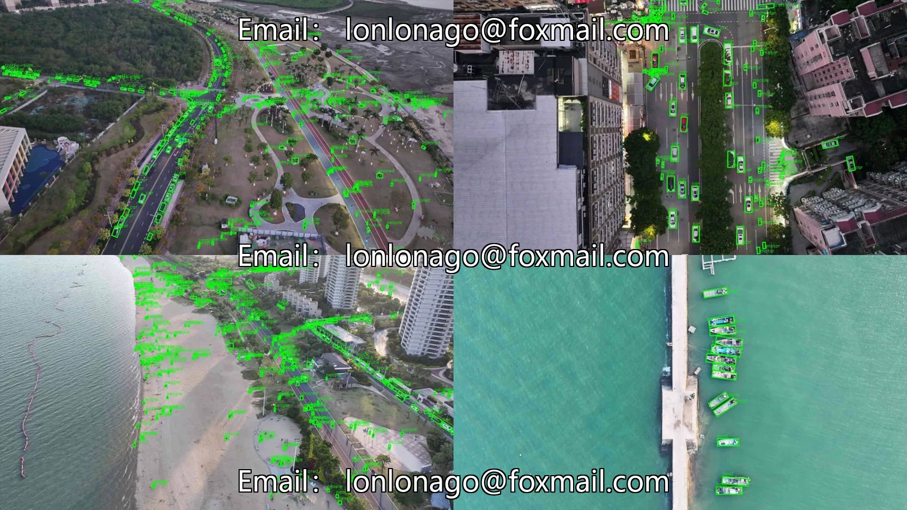
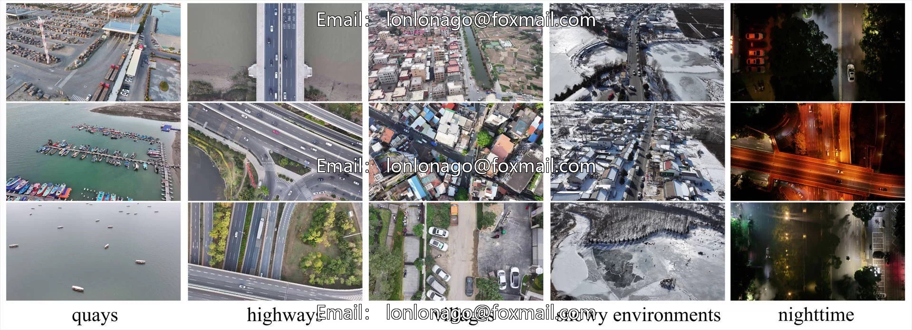
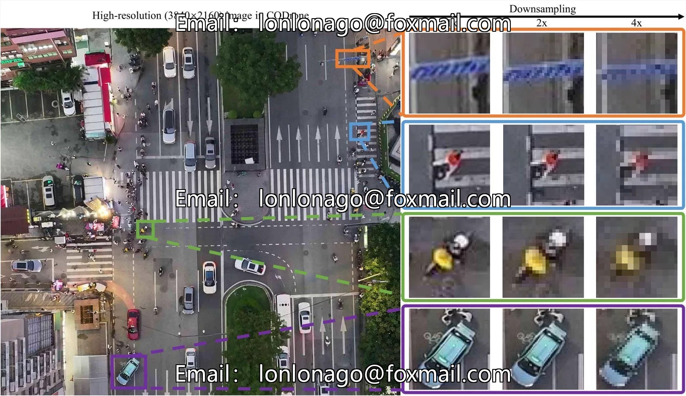
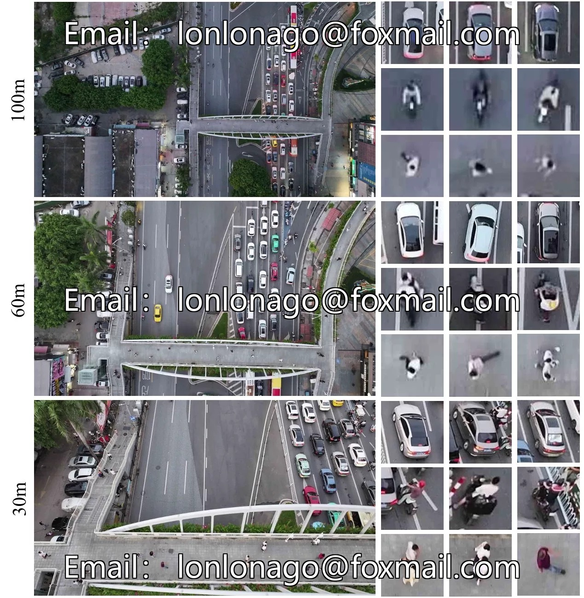

# High-definition UAV aerial photography inspection dataset, urban aerial photography dataset

## Body

High-definition UAV aerial photography inspection dataset, urban aerial photography dataset

Includes multiple scenes such as cities, towns, ports, industrial zones, etc., with a resolution of 3840×2160, covering a wide range of real scenes.

The dataset consists of 10,000 drone-collected images with 596,700 labeled targets, including key parameters such as image acquisition height and camera angle. It offers two annotation formats: DOTA (annfile folder) and VOC (labels folder), suitable for different detection model needs.

The dataset covers 12 categories of targets, breaking the limitation of most drone datasets focusing on vehicles. It fully covers scenarios such as cities, towns, ports, industrial areas, etc., supporting research related to drone attitude perception and promoting the development of high-resolution multi-scene detection technology.

Virtual materials, once sold, are non-refundable.
Interested friends, click "I want" to proceed.

## Images

## Payment

Here is a pay link on Stripe ( https://buy.stripe.com/3cs8yP7sY87d0vu9AB ). Please contact me lonlonago@foxmail.com after funding $89, and I will send you a complete data files , thank you!

